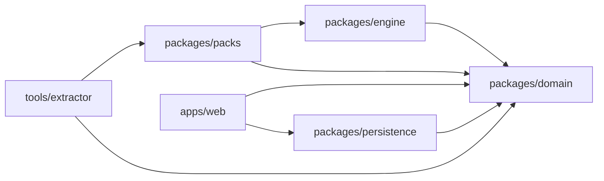

# Architecture map — spec §2 to code

The spec (`docs/spec/stationeers-engineer-spec-v2.2.md`) is authoritative; this file maps its layers onto the repo so new work lands in the right place.

## Layers → packages

| Spec layer (§2.2) | Code |
|---|---|
| Game data (build-time) | `tools/extractor` (adapters A–D), `packages/packs` (runtime schema/diff) |
| Domain model | `packages/domain` |
| Engineering engine | `packages/engine` |
| Presentation | `apps/web` |
| Persistence | `packages/persistence` |

## Monorepo mechanics

Bun workspaces. Package `exports` point at TypeScript source; Vite, Vitest, and tsc consume TS directly — no per-package build step. One root `tsconfig.json` typechecks everything.

## Contracts

- **Entity contract** — `packages/domain/src/entities.ts` holds the canonical entity interfaces (§4.1). Zod schemas mirror them for every runtime boundary; the two must not drift.
- **Serialization** — the project bundle (§9.1) stores devices, placements, construction elements, physical connections, and ConnectionIntents *separately*. Derived entities (resolved networks, rooms, intent topology status) are never serialized.
- **Canonical store (FND-04)** — all mutations are commands producing a patch + inverse; monotonic revision IDs; undo/redo replays patches; both editors re-derive views (§2.2.1).
- **Worker jobs** — every job carries the revision ID it started on; stale results are discarded or marked, never silently applied (§5.6).
- **Cache invalidation** — per-network / per-subgraph digests, never whole-project (§9.3).
- **Data packs** — versioned manifest with build, branch (stable only for published), tool versions, digests, coverage report, and channel: published vs user-generated (§6.4, §6.7).
- **Pack diff and invalidation (§6.6)** — `packages/packs` diffs two packs (`diffPacks`), reports coverage and publish blockers (`provenanceCoverageReport`), and applies the result to the behavior-model registry (`planModelInvalidation` → engine `findModelsAffectedBy`). This makes `packs` depend on `engine` for the one query that owns "which model consumes this name"; the edge is one-way — `engine` must never import `packs`. If engine work ever needs the diff, the bridge moves into the release tool that owns both.

## Module inventory

| Package | Modules |
|---|---|
| `packages/domain` | `entities.ts` (frozen contract) · `schemas/` (Zod v4 mirrors + project bundle + drift-pinned contract tests) · `store/` (commands, RFC 6902 patches + inverses, revisions, undo/redo, serializable log) |
| `packages/engine` | `numerics/` (f32/f64 helpers, decimal.js transcendentals, scalbn, bit access) · `jobs/` (revision-aware runner + named-protocol worker adapter) · `models/` (registry, envelopes, status propagation, result assembly) · `fixtures/` (reference fixture schema, replay/compare, coverage, capture workflow) |
| `packages/packs` | `schema` · `input` · `quality` (levels, ranks, approvals) · `build` · `load` · `canonical` · `diff` · `provenance-coverage` · `invalidation` · `limits` · `errors` |
| `packages/persistence` | `store` (Dexie projects + snapshots) · `autosave` · `migrate` · `transfer` (SHA-256 envelope, 9.4 caps) · `limits` |
| `apps/web` | `routes/` (projects, workspace tabs, design) · `components/{ui,status,schematic,projects}` · `state/` (project store adapter, persistence, project library, selection, undo/redo, intent topology, schematic layout, device catalog, export prompt, prefs) · `mocks/` (`mock.`-prefixed only) |
| `tools/extractor` | `adapters/xml/gamedata` (real `GameData` format) · `ir/` · `normalize` · `report` · `families` · `geometry/` (observations, protocol, worksheet, normalize, coverage, import) · `pack` · `version` · `cli` |

## Dependency graph

One-way edges only. `engine` must never import `packs`; `apps/web` will gain `packs` + `engine` edges when the catalog reads a real pack and analysis runs (SIM-02/03).

## Seams and handoffs (where the next work plugs in)

| Seam | Location | Replaced by |
|---|---|---|
| Physical-route resolution | `apps/web/src/state/intentTopology.ts` `resolvePhysicalRoute` | DOM-01's real resolver (segments/junctions, warnings, not-buildable) |
| Topology-status aggregation | `packages/engine/src/models/status.ts` + `result.ts` (`topologyStatus` is a caller input defaulting to `conceptual`) | DOM-02's network-side aggregator |
| Geometry records | `tools/extractor/src/geometry` → `geometry.json` at `extracted-unverified` | EXT-05 capture, then pack `payload.devices` via audited promotion |
| Catalog definitions | `apps/web/src/state/deviceCatalog.ts` (mock) | Pack loader once a published pack exists |
| Pack pin | `mock.pack.unpinned` / `packHash: 'unpinned'` placeholder | Real pack picker (EXT-03 packs become selectable) |
| Command log → persistence | `packages/domain/src/store` log export | Debounced snapshot + log-since-snapshot writes (§2.2.1) |
| Worker jobs in the app | `packages/engine/src/jobs` | Analysis wiring on SIM-02 |

**Trust gates (do not bypass):** a property becomes `extracted-and-validated` only through `pack --validated` promotions that name approver, time and evidence; a fixture yields `verified` only through `replayFixture` (pass ∧ in-envelope ∧ declared ∧ pinned build); a result is `exact` only when model status is Verified **and** topology status is Buildable.

## Determinism policy (§5.1.1, §5.5)

- All transcendental/power math via `packages/engine` numerics; fround at game-precision points as documented per behavior model.
- Golden fixture suite runs in every supported browser engine in CI (QA-01). Fixture tolerances apply to game comparison, not cross-browser.

## Status model (§3.5, §5.2)

- Model status: verified / unverified / unsupported / incompatible — weakest contributing status wins.
- Topology status: buildable / conceptual — conceptual if any contributing network depends on an unrouted intent, unplaced device, unverified footprint, or assumed volume.
- "Exact" requires both Verified and Buildable.

## Security (§9.4)

Imported bundles and packs are untrusted: file-size and decompressed-size caps, schema validation before migration, bounded graph sizes, no code execution, sanitized display strings, content-hash corruption detection, explicit rejection of unknown pack hashes and future schema versions.
